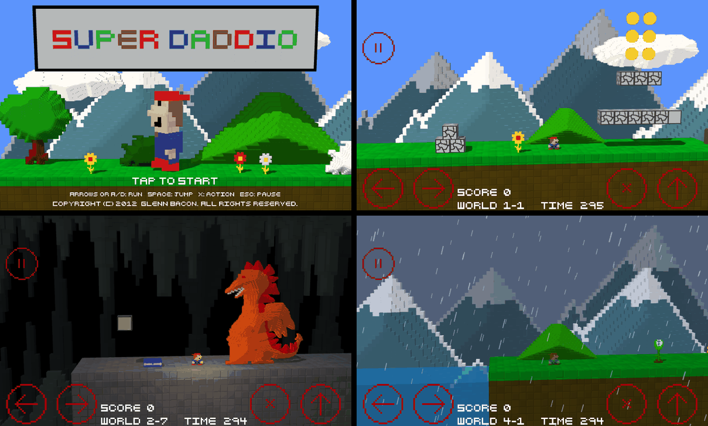

# Super Daddio 3D — voxel remake

The 2012 platformer, remade as a voxel diorama. The levels, the physics, the rules, the sound
effects and the music are the original's; what changed is how it is drawn. Every sprite and piece
of scenery is now a 3D voxel model built from the original pixel art, standing in a lane with real
depth, seen through a perspective camera, lit by a sun that casts shadows.

It runs in a web browser, on phones and desktops. All 60 levels are included.



This folder is a sibling of [`web/`](../web/), the faithful 2D port, and is built on it: the hero,
the enemies, the collision rules, the physics, the clock, input, save data and level files are the
same files. The game logic never knew how it was drawn, so only the renderer had to be replaced.

## Run it

You need [Node.js](https://nodejs.org/) 22 or newer.

```sh
npm install
npm run dev        # http://localhost:5173
```

```sh
npm run build      # static site in dist/ — host it anywhere
npm run preview    # serve dist/ locally
npm test           # headless tests: physics, game rules, level data, and the voxel mesher
```

Add `#level3-2` to the address to start directly in a level. An address ending in `debug`
(`#debug`, `#level3-2-debug`) puts the running game on `window.superdaddio` for the console.

## Controls

| | Keyboard | Touch |
|---|---|---|
| Run | ← → or A D | left edge of the screen / the area right of it |
| Jump (hold for height) | Space, ↑, W or Z | bottom-right button |
| Action: run faster, throw fireballs, release to throw a carried block | X, K or Shift | button left of jump |
| Pause | Esc or P | pause button |
| In the pause menu | P/Esc/Enter resume, R restart, M menu | tap the buttons |

The picture fills the window instead of being boxed into 5:3, so a wide phone sees more of the
level. A touch anywhere outside the 800 × 480 playfield counts as a touch on its nearest edge,
which makes the whole border of the screen an extension of the on-screen buttons.

## How the voxel look is made

**Models from the pixel art** (`src/engine/voxel/mesher.js`, `models.js`). Nothing was modelled by
hand. When a sprite frame is first needed, its pixels become columns of voxels:

- *Inflated* models (the hero, enemies, bosses, trees, hills, clouds…): a column is deeper the
  further its pixel lies from the outline, in whole voxel steps, so a flat drawing becomes a
  rounded, terraced figure. The front keeps the drawing exactly, with a little relief shading.
- *Extruded* models (signs, doors, platforms, the bridge): the drawing cut from a board.
- *Slabs* (terrain): the image cut through the whole depth of the lane, with a block pattern that
  runs unbroken across neighbouring pieces. Its top band — grass, snow, stone — becomes the ground
  you look down on.
- *Cubes* (bricks and power-up blocks): the 32 × 32 drawing on all six faces.
- Coins and keys are single cut-outs that really turn, instead of flipping through drawn frames.
- The mountain and cave backdrops are voxelised coarsely (8-pixel blocks) as one wrapping strip, so
  the relief matches where the tiles join.

`models.js` is one table saying, for each image, which of these it is and how deep.

**The lane** (`VoxelRenderer.js`). The hero, enemies and blocks live at depth 0. Terrain fills the
lane from back to front. Scenery the original drew behind the hero stands on the back half of the
ground; scenery it drew in front of him (flowers, rocks, some bushes and trees) on the front half.
The original painted such things overlapping the grass strip to fake depth; here they are lifted
to stand on the ground instead. Water is a see-through volume. The two scrolling backdrops stand
far behind the lane, enlarged so they cover what they covered in 2D, and haze over with distance.

**Camera and light.** The camera sits a little above and to one side and leans gently into the
direction of travel, which is what makes the depth readable. One sun lights everything and casts
shadows; caves are dark, and the hero carries a warm light with him. Night levels get stars. Rain
and snow are no longer a flat overlay: every drop and flake is a voxel somewhere in the depth of
the scene.

**Flat things stay flat.** The HUD, the menus and all text are drawn over the 3D picture exactly
as before. The title screen is the one scene that was rebuilt: the original was a single painted
picture, and here it is a small set made of level scenery.

The renderer adapts to slow devices: if frames take too long it first renders fewer pixels, then
drops the shadows.

## How it is organised

```
src/
  engine/
    voxel/
      mesher.js         pixels -> voxel columns -> merged quads (pure, no Three.js; tested in Node)
      models.js         which image becomes which kind of model, and where it stands in depth
      VoxelRenderer.js  the 3D scene, the camera, the lights, and the flat overlay for HUD and menus
      sky.js            rain, snow and stars
    display.js          2D display list the game logic builds (unchanged)
    physics.js, clock.js, input.js, save.js, audio.js   (as in web/, audio now loads from memory)
    assets.js           loads the packed assets
  game/                 the game itself (as in web/; scenes tag their groups with a `layer`)
  levels/               level data, one JSON file per level (as in web/)
  assets/               images, sounds, font (the originals; world-select thumbnails re-shot in 3D)
tools/
  pack-assets.mjs       packs images, sounds and levels into a few files under public/data/
  extract/              the level extractor (as in web/)
tests/                  as in web/, plus mesher.test.js
```

Scenes tell the renderer what their groups are by setting `group.layer`: `world` and `front` for
the level, `far1` and `far2` for the backdrops, `sky` for the background colour. Anything untagged
is drawn flat. That, a `renderHints()` method on the level and title scenes, the rebuilt title
screen and a line of key hints on it are the only changes to the game code.

`npm test` checks every frame of every sprite: the voxel model must be a closed surface whose
volume equals that of its columns, which catches a missing, doubled or inside-out wall.

## Differences from the 2D port

- Everything listed above about how it looks.
- The view is not letterboxed; see Controls.
- `#level3-2` in the address replaces `?level=level3_2`.
- Assets are packed into a few files (`npm run pack`, run automatically by `dev` and `build`), so
  the game starts with a handful of requests instead of several hundred.
- The world-select thumbnails for worlds 1–7 are screenshots of this version.
- The copyright line on the title screen is typed rather than painted, and reads "(C)" because the
  pixel font has no © sign.

Gameplay is untouched: the original test suite passes unchanged.

## Licence

The code is MIT-licensed. The artwork, sound effects and music in `src/assets/` belong to Glenn
Bacon and are for non-commercial use only, and the font is someone else's work. See the
[README](../README.md#licence) at the top of the repository.
